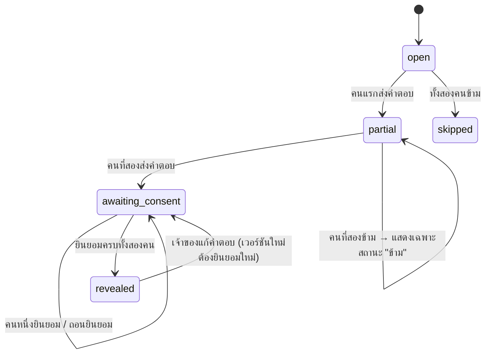

# 04 — Personality System

> เจ้าของข้อมูล: กฎการเก็บ ประมวลผล เปรียบเทียบ และแสดงผลข้อมูลบุคลิกภาพ
> Schema อยู่ใน [07-data-architecture.md](07-data-architecture.md) · คำถามอยู่ใน [03-question-bank.md](03-question-bank.md)

---

## 1. หลักการ

1. **สามชั้นข้อมูลแยกกันเด็ดขาด** — ไม่มีการรวม เฉลี่ย หรือเขียนทับข้ามชั้น
2. **ไม่มีป้ายบุคลิก** — ไม่สรุปเป็น "ประเภท" ไม่มีชื่อเรียกแบบ MBTI/Enneagram/"ภาษารัก 5 แบบ"
3. **ไม่มีตัวเลขที่ตัดสิน** — ไม่มี Score, %, อันดับ, เกจ หรือการนับที่สื่อว่า "เข้าใจกันมาก/น้อย"
4. **ผู้เล่นเป็นเจ้าของข้อมูล** — แก้ไข ซ่อน ลบได้ตลอด
5. **ไม่แน่ใจคือคำตอบที่ถูกต้อง** — Meta answer มีน้ำหนักเท่าคำตอบปกติในการแสดงผล

---

## 2. สามชั้นข้อมูล

| ชั้น | Key | ใครเป็นเจ้าของ | เกี่ยวกับใคร | แหล่งที่มา | การแสดงผล |
|---|---|---|---|---|---|
| Self-reported | `self` | ผู้เล่น X | ผู้เล่น X | Personality Setup (Q01–Q36), Mirror self (M01–M07 ของ Journey นั้น), Interpretation `layer=self`, Reflection | "สิ่งที่คุณบอก" |
| Perceived | `perceived` | ผู้เล่น X | ผู้เล่น Y (หรือ Imagined Partner) | Personality Setup แบบ Perceived, Mirror perceived, Interpretation `layer=perceived` | "สิ่งที่คุณคิดเกี่ยวกับ {Y}" + ป้าย "สมมติฐาน" |
| Observed (Phase 2) | `observed` | ระบบ (ผู้เล่น X ควบคุม) | ผู้เล่น X เท่านั้น | Story choice tags (เฉพาะตอนเล่นบทบาทของตัวเอง) | "รูปแบบที่เกมสังเกต" + ป้าย "อาจ" |

**Imagined Partner (Play Alone):** มีเฉพาะชั้น `self` ของผู้เล่น และ `perceived` ที่ผู้เล่นสร้างเกี่ยวกับคู่ — ไม่มีชั้น `self` ของคู่ ช่องนั้นแสดง "ยังไม่รู้"

### 2.1 Data Scope (Global vs Journey)

| ข้อมูล | ขอบเขต | เหตุผล |
|---|---|---|
| Player, Appearance | Global (ต่อผู้เล่น) | ใช้ซ้ำได้ทุก Journey |
| Profile Self Q01–Q36 | Global (ต่อผู้เล่น) | "ตัวฉัน" มีค่าเดียว |
| Profile Perceived Q01–Q36 | Global (ต่อคู่ owner→about) | ความคิดเกี่ยวกับคนเดิมมีค่าเดียว |
| Mirror M01–M07 (self + perceived) | **ต่อ Journey** | ผูกกับบริบทการเล่นและการ Reveal ของ Journey นั้น |
| W3 (`w3_1`, `w3_2`) | **ต่อ Journey, `context: 'role'`** | ตอบในบทบาทสมมติ — **ไม่นับใน Profile และไม่ใช้ใน Comparison/Report** ใช้เฉพาะฉาก Ch3 |
| Reflection, Interpretation, Emotion cards | ต่อ Journey | — |
| Ch5 Statements | ต่อ Journey | — |
| Comparison, Report | **ต่อ Journey** = Profile (global) + ข้อมูลของ Journey นั้น | — |

---

## 3. การบันทึกคำตอบ

### 3.1 รูปแบบคำตอบ (ย่อจาก `PersonalityAnswer` ใน 07)

| ฟิลด์ | กฎ |
|---|---|
| `selected` | Array ของ option id · ความยาว 0..`maxSelect` |
| `meta` | `null` \| `depends` \| `not_sure` \| `prefer_not` \| `skipped` |
| `freeText` | ไม่บังคับ ≤ 280 ตัวอักษร เก็บเป็น plain text |
| `status` | `answered` \| `skipped` |

### 3.2 Validation

| เงื่อนไข | ผล |
|---|---|
| `meta = null` และ `selected.length = 0` และไม่มี `freeText` | ปุ่ม "ถัดไป" ปิด — ต้องเลือกอย่างน้อย 1 หรือเลือก Meta |
| `meta = null` และ `selected.length = 0` และมี `freeText` | อนุญาต (ตอบด้วยคำพูดตัวเอง) |
| `meta ∈ {depends, not_sure, prefer_not}` | `selected` ต้องว่าง · `freeText` อนุญาต |
| `meta = skipped` | `selected` ว่าง · `freeText` ว่าง · `status = skipped` |
| เลือกเกิน `maxSelect` | ตัวเลือกที่เหลือ disabled พร้อมข้อความ "เลือกได้สูงสุด N ข้อ" |
| เลือก option ที่ `exclusive: true` (เช่น "ไม่มี") | ล้างตัวเลือกอื่นทั้งหมด · เลือกตัวเลือกอื่นภายหลัง → ล้าง exclusive ออก · `selected` มี exclusive ได้อย่างมาก 1 และอยู่คนเดียว |

### 3.3 การบันทึกและแก้ไข

- Autosave ทันทีเมื่อกด "ถัดไป" หรือเปลี่ยนคำถาม
- แก้ไขได้ตลอดจาก Profile → คำถาม → แก้ไข
- เก็บ `updatedAt` และ `revision` (จำนวนครั้งที่แก้) ไม่เก็บค่าเก่า (ลดข้อมูลที่ต้องดูแล) — ยกเว้นกรณีที่คำตอบเคยถูก Reveal ดู §6.4

---

## 4. การประมวลผลสำหรับ Profile

ทำแบบ Deterministic ฝั่ง Client ไม่มี ML ไม่มี LLM

### 4.1 Dimension Summary (ต่อผู้เล่น ต่อชั้น)

```
for each dimension D:
  answers = คำตอบทั้งหมดในชั้นนั้นที่ question.dimension = D และ status = answered
  concrete = answers ที่ meta = null
  uncertain = answers ที่ meta ∈ {depends, not_sure}
  hidden = answers ที่ meta = prefer_not
  summary[D] = {
    statements: concrete.map(a => template(a.question, a.selected)),   // ประโยคต่อคำตอบ
    uncertainCount > 0 ? "บางเรื่องในหมวดนี้คุณบอกว่าขึ้นอยู่กับสถานการณ์หรือยังไม่แน่ใจ" : null,
    state: concrete.length > 0 ? "has_data" : uncertain.length > 0 ? "uncertain" : "empty"
  }
```

- `statements` สร้างจาก Template ต่อคำถาม เช่น Q13 self → "เวลาเสียใจ คุณอยากได้รับ: {options}" (รวมตัวเลือกด้วย " · ")
- ไม่มีการคำนวณ "ค่าเฉลี่ย" หรือ "ระดับ" ของมิติ
- `state = empty` → แสดง "ยังไม่มีข้อมูลในหมวดนี้" + ปุ่ม "ตอบคำถามหมวดนี้"

### 4.2 คำที่ห้ามใช้ในข้อความที่ระบบสร้าง

`toxic` · `ปกติ/ผิดปกติ` · `ดีกว่า/แย่กว่า` · `ถูก/ผิด` (กับคำตอบ) · `ขี้หึง` · `เย็นชา` · `เอาแต่ใจ` · `เก็บกด` · `ไม่มีวุฒิภาวะ` · `เข้ากันได้ X%` · `คะแนน` · ชื่อโรคหรือภาวะทางจิตเวชทุกชนิด

มี Unit test ตรวจ Content files ทั้งหมดว่าไม่มีคำในรายการนี้ ([11](11-testing-and-acceptance-criteria.md) TC-SAFE-01)

---

## 5. Observed Gameplay Patterns (Phase 2)

> **ย้ายออกจาก MVP** (audit M-7): ต่อการเล่นหนึ่งรอบมีจุดเลือกราว 14 จุด มิติส่วนใหญ่ไม่ถึงเกณฑ์ 3 สัญญาณ ฟีเจอร์จึงแทบไม่แสดงผลใน MVP · MVP **ไม่เก็บ** ObservedSignal (PR4: ไม่เก็บข้อมูลที่ไม่ได้ใช้) · Content ยังใส่ `tag` ไว้ได้เพื่อใช้ใน Phase 2 · Phase 2 ต้องเพิ่ม tag ให้มิติที่มีน้อยกว่า 3 ก่อนเปิดใช้
> เก็บเฉพาะ `layer = self` — ไม่มี `observed.perceived` (ไม่มีหน้าจอใดใช้)
>
> **ทำแล้ว (M11b, 2026-11-23):** คำนวณสดจาก `choiceLog` ที่บันทึกอยู่แล้ว + `tag` ใน Content (`src/engine/observed.ts`) — **ไม่เก็บ** ObservedSignal เพิ่ม · นับเฉพาะตัวเลือกที่ผู้เล่นเลือกในบทบาทของตัวเอง (`asRole = self` หรือ role ที่ map เป็นผู้เล่นคนนั้น) · หนึ่งสัญญาณต่อ choice ต่อ journey (รอบล่าสุด) · เก็บเฉพาะ feedback ของผู้เล่น (`confirmedObserved`, `hiddenObservedCards` ใน profile `X:self`) · หน้า Profile Hub แสดงหลัง PIN · การ์ดที่ซ่อนกู้คืนได้จากปุ่ม "แสดงการ์ดที่ซ่อนไว้" ในส่วนเดียวกัน

### 5.1 การเก็บสัญญาณ

- ทุก Choice ที่มี `tag = "Dxx:signal"` ([02](02-story-script.md) §0.7) เมื่อถูกเลือก → เพิ่ม `ObservedSignal { dimension, signal, sourceChoiceId, layer }`
- เก็บเฉพาะเมื่อผู้เลือกกำลังเล่นบทบาทของตัวเอง · ตัวเลือกที่เลือกในบทบาทของคู่ไม่ถูกเก็บเป็นสัญญาณ
- เล่นบทซ้ำ: สัญญาณจากการเล่นครั้งใหม่ของ Choice เดิม **แทนที่** ของเดิม (นับ 1 สัญญาณต่อ Choice เสมอ)

### 5.2 เงื่อนไขการแสดง (A-15)

| เงื่อนไข | ผล |
|---|---|
| สัญญาณในมิติเดียวกัน < 3 | ไม่แสดง |
| สัญญาณ ≥ 3 และ signal เดียวกันปรากฏ ≥ 2 ครั้ง | แสดง 1 การ์ด สำหรับ signal นั้น |
| สัญญาณ ≥ 3 แต่ไม่มี signal ซ้ำ | แสดง "ตัวเลือกของคุณในหมวดนี้หลากหลาย" |
| ผู้เล่นเคยกด "ซ่อน" การ์ดนี้ | ไม่แสดงอีก (กู้คืนได้ใน Settings) |

### 5.3 ข้อความการ์ด

```
จากตัวเลือกในเนื้อเรื่อง คุณมัก{signal_text}
นี่อาจบอกอะไรบางอย่างเกี่ยวกับตัวคุณ — หรืออาจเป็นแค่สิ่งที่เลือกในเกมก็ได้
[ ใช่ ตรงกับฉัน ]  [ ไม่ค่อยตรง ]  [ ซ่อน ]
```
- `ใช่` → บันทึก `confirmed = true` แสดงใน Report ส่วน "รูปแบบที่คุณยืนยัน"
- `ไม่ค่อยตรง` → `confirmed = false` ไม่แสดงใน Report
- ไม่มีการกระทำ → ไม่แสดงใน Report (แสดงเฉพาะในหน้า Profile)
- Observed **ไม่เขียนทับ** Self-reported ไม่ว่ากรณีใด ถ้าขัดกัน แสดงทั้งสองโดยไม่ชี้ว่าอันไหนจริง

### 5.4 Signal Registry

| Signal | `signal_text` |
|---|---|
| D01:open | บอกความรู้สึกออกมาตรง ๆ |
| D01:downplay | บอกว่าไม่เป็นไร แม้สถานการณ์จะหนัก |
| D01:hold_back | เก็บสิ่งที่อยากพูดไว้ก่อน |
| D01:light_humor | ใช้อารมณ์ขันทำให้บรรยากาศเบาลง |
| D02:reach_out | ติดต่ออีกฝ่ายก่อน |
| D02:acknowledge | รับฟังและตอบรับคำพูดของอีกฝ่าย |
| D03:confront | พูดถึงสิ่งที่ไม่พอใจออกมาทันที |
| D04:seek | ขอความช่วยเหลือหรือการยืนยันจากคนอื่น |
| D04:verbal | อยากได้ยินคำปลอบเป็นคำพูด |
| D05:physical | อยากได้รับความอบอุ่นทางกาย |
| D05:listen | อยากมีคนรับฟัง |
| D06:solve | มุ่งไปที่การแก้ปัญหา |
| D07:space | ขอพื้นที่หรือความเงียบ |
| D07:self_contained | จัดการเองก่อนบอกคนอื่น |
| D08:togetherness | ชวนอีกฝ่ายทำด้วยกัน |
| D08:presence | อยู่ข้าง ๆ แม้ไม่ได้พูดอะไร |
| D08:physical_consent | ถามก่อนแสดงความใกล้ชิด |
| D09:act | ลงมือทำอะไรบางอย่างทันที |
| D09:self_regulate | พยายามทำใจให้สงบก่อน |
| D09:withdraw | ถอยเข้าหาตัวเอง |
| D09:connect | หาคนคุยด้วย |
| D09:comfort_memory | นึกถึงความทรงจำดี ๆ |
| D09:restless | อยู่นิ่งไม่ได้ |
| D10:repair_first | เริ่มต้นการคืนดีก่อน |
| D11:state_limit | บอกขอบเขตของตัวเอง |
| D12:gratitude | แสดงความขอบคุณ |

---

## 6. Perspective Mirror & Reveal Rules

### 6.1 หน่วยของ Mirror

`MirrorItem` = (questionId, sessionId) ประกอบด้วยคำตอบสูงสุด 4 ชิ้น:

| ชิ้น | ความหมาย |
|---|---|
| `A.self` | A ตอบเรื่องตัวเอง |
| `A.perceived` | A เดาเรื่อง B |
| `B.self` | B ตอบเรื่องตัวเอง |
| `B.perceived` | B เดาเรื่อง A |

การเปรียบเทียบที่แสดง:
- **มุม A:** `A.self` ↔ `B.perceived` → "สิ่งที่ {A} รู้สึก vs สิ่งที่ {B} คิด"
- **มุม B:** `B.self` ↔ `A.perceived`
- **เทียบตรง:** `A.self` ↔ `B.self` (ใช้ใน Comparison หมวด "ต่างกัน/คล้ายกัน")

### 6.2 State Machine (Play Together / Remote)



| กฎ | รายละเอียด |
|---|---|
| R1 | ไม่มีคำตอบของใครแสดงให้อีกฝ่ายก่อนสถานะ `revealed` |
| R2 | การยินยอมเป็นต่อคน ต่อข้อ (หรือต่อชุด ถ้าเลือก "เปิดทีเดียวตอนจบบท" = ยินยอมทุกข้อในชุดพร้อมกัน แต่ยังเลือกยกเว้นรายข้อได้) |
| R3 | ถอนการยินยอมได้จนกว่าจะเป็น `revealed` |
| R4 | `meta = prefer_not` → อีกฝ่ายเห็นเพียง "{X} เลือกไม่ตอบข้อนี้" แม้ `revealed` |
| R5 | ถ้าคนหนึ่ง `skipped` → อีกคนยัง Reveal คำตอบของตัวเองได้ถ้ายินยอม (แสดง "{X} ข้ามข้อนี้") |
| R6 | หลัง `revealed` ไม่สามารถ "ลบความทรงจำ" ของอีกฝ่ายได้ ระบบแจ้งตรง ๆ ก่อนกดยินยอม: "เมื่อเปิดแล้ว {other} จะได้เห็นคำตอบนี้" |
| R7 | แก้คำตอบหลัง `revealed` → เวอร์ชันเก่าไม่แสดงอีก, เวอร์ชันใหม่ต้องยินยอมใหม่ทั้งคู่ |

### 6.3 Play Alone

- ไม่มี State machine ทุกอย่างเป็นของผู้เล่นคนเดียว
- แสดงทันที: `self` ↔ `perceived` ของตัวเอง โดยมุมของคู่แสดงสองช่อง: "สิ่งที่คุณคิดว่า {other} ต้องการ" และ "สิ่งที่ {other} บอก: ยังไม่รู้"
- ปุ่ม "เพิ่มเป็นคำถามที่อยากถาม" → บันทึก `reflectionPrompt` ลง Next Conversation

### 6.3.0 Profile Questions (Q01–Q36) ใน Together/Remote

คำตอบ Profile เป็น global แต่การเปิดให้คู่เห็นเป็น **ต่อ Journey** (ทำแล้วใน M10b):
- การเปิดหนึ่งข้อครอบคลุม **คำตอบเกี่ยวกับตัวเอง และสิ่งที่คิดเกี่ยวกับคู่** ในข้อนั้นของเจ้าของ (เพื่อให้เทียบมุมของ A / มุมของ B / เทียบตรงได้)
- "เลือกข้อที่ยอมเปิด" = ส่งและยินยอมพร้อมกัน ข้อเปิดเมื่อทั้งคู่เลือกข้อเดียวกัน · ถอนได้จนกว่าจะเปิด · ไม่แสดงว่าอีกคนเลือกข้อไหน
- R7: revision ของข้อ = revision(self) + 100000 × revision(perceived) แก้ข้อใดข้อหนึ่งแล้วข้อนั้นถูกซ่อนทันที และต้องเลือกเปิดใหม่ทั้งคู่
- เดิม:  ใช้ `SharedAnswer` key = `Qxx` ใน Journey นั้นที่เก็บเฉพาะ consent + `revealedRevision` (ไม่คัดลอกคำตอบ) ตอนแสดงผลอ่านคำตอบจาก Profile และเปิดเฉพาะถ้า `revision` ปัจจุบันตรงกับ `revealedRevision` (R7) · หน้าจอ S8 มีปุ่ม "เลือกคำตอบบุคลิกภาพที่จะเปิดให้ {other} เห็น" (ค่าเริ่มต้น: ไม่เลือก)

### 6.3.1 Ch5 Statements

Statements (`cs1`–`cs5`) ใช้ `SharedAnswer` และ State machine เดียวกับ Mirror ([07](07-data-architecture.md) §7) ต่างกันที่:
- แต่ละคนตั้ง `shareIntent` เองต่อข้อ (ค่าเริ่มต้น `false`) · ข้อที่ `shareIntent=false` ไม่ถูกเปิดไม่ว่ากรณีใด
- Reveal เกิดเมื่อทั้งสองคนกด "เปิดพร้อมกัน" (consent ระดับชุด) → เปิด **เฉพาะข้อที่เจ้าของเลือกแชร์** ของแต่ละคน (ไม่จำเป็นต้องแชร์ข้อเดียวกัน)
- ไม่มีการเปรียบเทียบหรือจัดหมวด

### 6.4 ประวัติการ Reveal

เก็บเฉพาะ `revealedAt` และ `revealedRevision` ของแต่ละ MirrorItem เพื่อให้ R7 ทำงาน ไม่เก็บค่าเก่า

---

## 7. Personality Comparison

### 7.1 Input

คำนวณต่อ Journey (§2.1) จาก Profile Q01–Q36 + Mirror M01–M07 ของ Journey นั้น · ไม่ใช้ W3 · ต้องมีอย่างน้อย 1 คู่ที่เปรียบเทียบได้ (ไม่อย่างนั้นแสดง Empty state)

| โหมด | คู่ที่ใช้ |
|---|---|
| Play Alone | `A.self` ↔ `A.perceived(Imagined)` ต่อคำถามเดียวกัน → ใช้แยก "สิ่งที่คุณคิดว่าเหมือน/ต่างกัน" + ทุกข้อของคู่เข้าหมวด "ควรถามกัน" |
| Together / Remote | เฉพาะข้อที่ `revealed` แล้ว: `A.self↔B.perceived`, `B.self↔A.perceived`, `A.self↔B.self` |

### 7.2 กฎจัดหมวด (ต่อคู่ ต่อคำถาม)

```
function categorize(x, y):
  if x missing or y missing or x.status = skipped or y.status = skipped: return "ask"
  if x.meta = prefer_not or y.meta = prefer_not: return "excluded"          // ไม่แสดงในหมวดใด
  if x.meta ∈ {depends, not_sure} or y.meta ∈ {depends, not_sure}: return "ask"
  if x.selected empty or y.selected empty (ตอบด้วยข้อความอิสระอย่างเดียว): return "ask"
  if intersect(x.selected, y.selected) non-empty: return "similar"
  return "different"
```

**การตรงกันใช้ suffix ของ option id** (เช่น `q22_touch` กับ `q23_touch` ไม่ถือว่าเป็นข้อเดียวกัน เพราะต่างคำถาม — เปรียบเทียบเฉพาะคำถามเดียวกันเท่านั้น)

### 7.3 สามหมวดที่แสดง

| หมวด | หัวข้อบนหน้าจอ | ประโยคแม่แบบ |
|---|---|---|
| `similar` | สิ่งที่เราเข้าใจคล้ายกัน | "เรื่อง{dimension_name} — คุณสองคนเลือก {shared_options}" |
| `different` | สิ่งที่เราอาจรู้สึกต่างกัน | "เรื่อง{dimension_name} — {X} เลือก {x_options} ส่วน {Y} เลือก {y_options} · ความต่างนี้ไม่ได้แปลว่าใครถูก" |
| `ask` | สิ่งที่เราควรถามกัน | "{reflectionPrompt}" + บริบทสั้น ๆ ว่าทำไมอยู่หมวดนี้ (ยังไม่แน่ใจ / ยังไม่ได้ตอบ / ตอบด้วยคำพูดของตัวเอง) |

### 7.4 กฎการแสดงผล

- **ไม่แสดงจำนวน** รายการในแต่ละหมวด (ไม่มี "5 เรื่องที่เข้าใจตรงกัน")
- เรียงตามมิติ D01→D12 ภายในหมวด
- หมวด `different` เปิดด้วยข้อความ: *"คุณอาจแสดงความใส่ใจต่างกัน แม้ทั้งสองคนต่างอยากดูแลความสัมพันธ์นี้"*
- ถ้าหมวดใดว่าง: แสดงข้อความกลาง ๆ เช่น "ยังไม่มีเรื่องในหมวดนี้" (ไม่ใช่ "เยี่ยม! ไม่มีความต่าง")
- ทุกการ์ดแตะเพื่อดูคำถามเต็มและเพิ่มลง Next Conversation ได้
- Perceived ที่ยังไม่ Reveal **ไม่ถูกนำมาใช้** ใน Comparison ของอีกฝ่าย

### 7.5 What You See vs. What I Feel (Ch3)

ใช้กฎเดียวกับ §7.2 แต่แสดงเป็นคู่การ์ดหน้า-หลังในฉาก: ด้านซ้าย "สิ่งที่ {viewer} เห็น" ด้านขวา "สิ่งที่ {owner} รู้สึก" พร้อมข้อความตามหมวดจาก [02](02-story-script.md) Ch3 §S05

---

## 8. Reflection Report Generation

Report เป็นของผู้เล่นหนึ่งคนในหนึ่ง Journey (§2.1) · ทุกส่วนสร้างจาก Template + ข้อมูลจริงเท่านั้น ถ้าไม่มีข้อมูล แสดงสถานะว่างพร้อม CTA

| ส่วนของ Report | แหล่งข้อมูล | ถ้าว่าง |
|---|---|---|
| My Personality: ความต้องการทางอารมณ์ | self ของ D04, D05, D07 | "ยังไม่ได้ตอบ — [ตอบ 3 คำถาม]" |
| My Personality: วิธีแสดงความรัก | self ของ D08 | เช่นเดียวกัน |
| My Personality: วิธีรับมือความขัดแย้ง | self ของ D03, D10 | เช่นเดียวกัน |
| My Personality: อะไรทำให้รู้สึกถูกรัก | self ของ M02, Q34, cs4 | เช่นเดียวกัน |
| My Understanding: สิ่งที่ฉันคิดว่าเขาต้องการ | perceived ของ D05, M01, M07 | — |
| My Understanding: สิ่งที่ฉันคิดว่าทำให้เขารู้สึกถูกรัก | perceived ของ D08, M02 | — |
| My Understanding: สิ่งที่ฉันยังไม่เข้าใจ | perceived ที่เป็น `not_sure`/`depends`/`skipped` | "คุณตอบได้ทุกข้อ — แต่อย่าลืมว่าทุกข้อยังเป็นสิ่งที่คุณคิด" |
| Our Differences | หมวด `different` (Together/Remote เท่านั้น) · Solo: แสดง "ต้องให้ {other} มาเล่นด้วยก่อน" | — |
| Our Next Conversation: คำถาม | หมวด `ask` + r4_3 + r5_2 + รายการที่ผู้เล่นเพิ่มเอง | — |
| Our Next Conversation: สิ่งที่ควรขอบคุณ | self ของ Q34 ของอีกฝ่าย (Revealed) | — |
| Our Next Conversation: วิธีดูแลกัน | Q26, Q13 ของอีกฝ่าย (Revealed) หรือ perceived (Solo, มีป้าย) | — |
| รูปแบบที่คุณยืนยัน (Phase 2) | Observed ที่ `confirmed = true` | ไม่แสดงส่วนนี้ (ทำแล้ว M11b — แสดงเมื่อมีอย่างน้อย 1 รายการ) |

Report เป็นของผู้เล่นแต่ละคน ไม่มี Report รวมที่แสดงข้อมูลส่วนตัวของอีกฝ่ายโดยไม่ได้ Reveal — **Shared Reflection** ใน Ch5 แสดงเฉพาะ Statements ที่ทั้งสองแชร์ และ MirrorItem ที่ Revealed เท่านั้น
