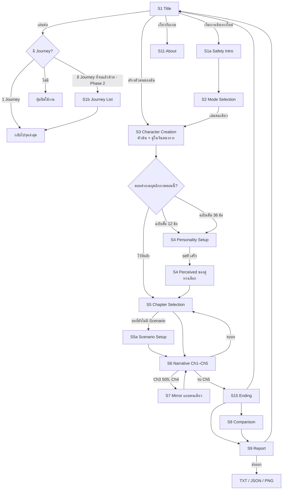
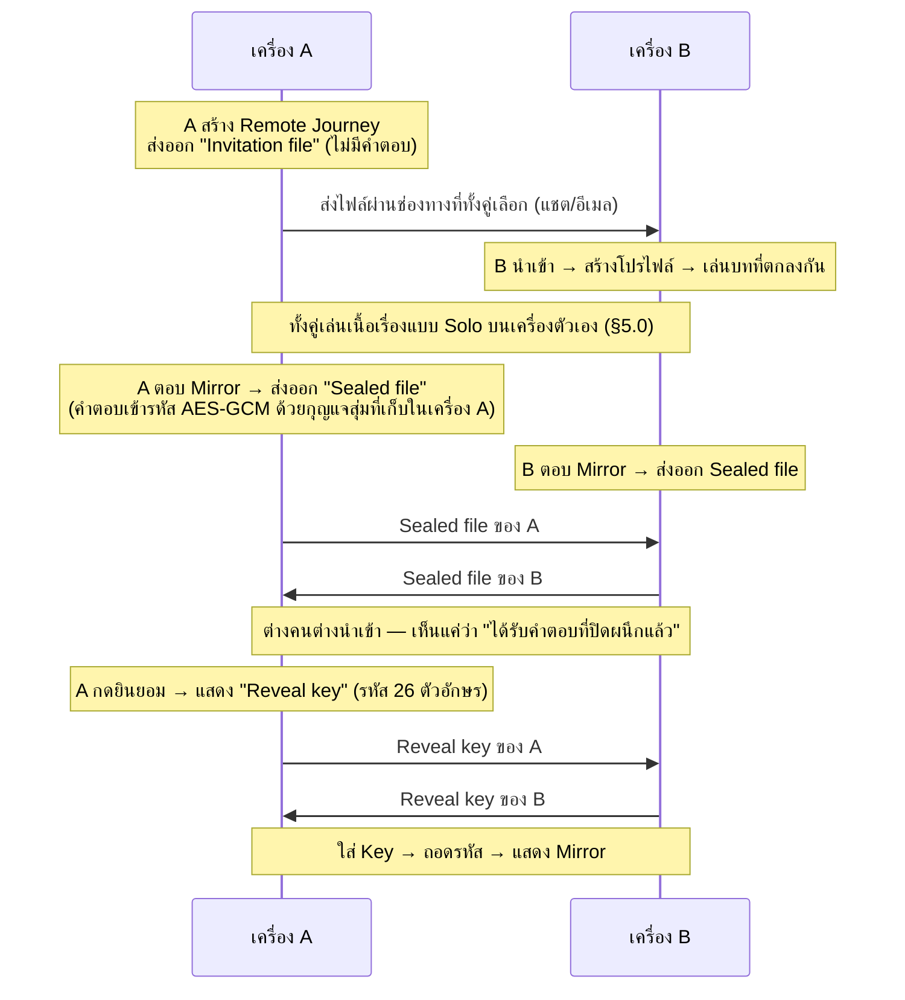
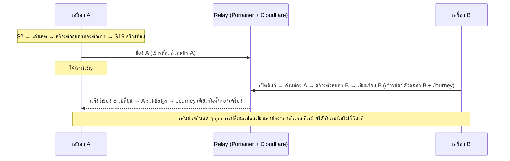

# 05 — Game Flow

> เจ้าของข้อมูล: ลำดับหน้าจอ จุดเริ่ม/จบ การข้าม การเล่นต่อ และกรณีข้อมูลไม่ครบ ของทุกโหมด
> รายละเอียดหน้าจออยู่ใน [06-ui-ux-specification.md](06-ui-ux-specification.md) (ใช้ Screen ID เดียวกัน)

---

## 1. Screen Registry

| ID | หน้าจอ | Route (hash) | Phase |
|---|---|---|---|
| S1 | Title Screen | `#/` | MVP |
| S1b | Journey List | `#/journeys` | Phase 2 (MVP มี Journey ที่ใช้งานได้ทีละ 1 อัน) |
| S1a | Safety Intro | `#/intro` | MVP |
| S2 | Mode Selection | `#/mode` | MVP (Together/Remote แสดงเป็น "เร็ว ๆ นี้" จนกว่าจะถึง Phase) |
| S3 | Character Creation | `#/players` | MVP |
| S4 | Personality Setup | `#/profile/:playerId/:layer` | MVP |
| S5 | Chapter Selection | `#/j/:journeyId/chapters` | MVP |
| S5a | Scenario Setup | `#/j/:journeyId/scenario` | MVP |
| S20 | เลือกคนเล่า (เส้นเรื่องที่ 2) | `#/j/:journeyId/teller?next=…` | M16 |
| S6 | Narrative Gameplay | `#/j/:journeyId/play/:chapterId` | MVP |
| S7 | Perspective Mirror | `#/j/:journeyId/mirror/:questionId` (ภายใน Ch3/Ch4 ใช้เป็น overlay) | MVP |
| S8 | Personality Comparison | `#/j/:journeyId/compare` | MVP |
| S9 | Reflection Report | `#/j/:journeyId/report/:playerId` | MVP |
| S10 | Settings & Privacy | `#/settings` | MVP |
| S11 | About & Safety Resources | `#/about` | MVP |
| S12 | Handoff Screen | overlay | Phase 2 |
| S13 | PIN Gate | overlay | Phase 2 |
| S14 | Pause Menu | overlay | MVP |
| S15 | Ending | `#/j/:journeyId/ending` | MVP |
| S16 | Memory Scenes | `#/memories` | Phase 2 |
| S17 | Remote Lobby | `#/remote` | Phase 3 |
| S19 | Live Lobby (เล่นสด) | `#/live` · ลิงก์เชิญ `#/live?join=…` หรือกรอกโค้ดห้อง `XXXXX-XXXXX` | Phase 3C |
| S18 | Data Recovery | `#/recovery` | MVP |

**Profile Hub** เป็นส่วนหนึ่งของ S3 (แท็บ "โปรไฟล์") เข้าถึงได้จาก S5 และ S10

---

## 2. Global Rules

| กฎ | รายละเอียด |
|---|---|
| G1 Autosave | บันทึกลง localStorage ทุกครั้งที่: เลือก Choice, ตอบคำถาม, จบฉาก, เปลี่ยนหน้าจอ, แก้โปรไฟล์ |
| G2 Resume point | `ChapterProgress.currentSceneId` + `lineIndex` (กลับไปต้นบรรทัด Dialogue ล่าสุด ไม่ใช่กลางการพิมพ์) |
| G3 No dead ends | ทุกหน้าจอมีปุ่มกลับหรือปุ่มไป S1/S5 · ทุก overlay ปิดได้ |
| G4 Pause | ปุ่มหยุดอยู่มุมขวาบนทุกหน้าใน S6/S7 และกด `Esc` ได้ |
| G5 Skip scene | จาก S14 → "ข้ามฉากนี้" → ไปฉากถัดไปตามลำดับ Flag ที่ไม่ได้ตั้งใช้ fallback ([02](02-story-script.md) ภาคผนวก B) |
| G6 Skip chapter | จาก S14 หรือ S5 → "ข้ามบทนี้" → สถานะ `skipped` → บทถัดไปเปิดได้ |
| G7 Skip question | ทุกคำถามมี Meta `ข้าม` |
| G8 Chapter access | ทุกบทเปิดเล่นได้ตั้งแต่ต้น แต่ S5 แนะนำลำดับ 1→5 · ถ้ายังไม่มี Scenario (ข้าม Ch1) → เข้า Ch1–Ch3 ต้องผ่าน S5a ก่อน (Ch4, Ch5 ไม่ใช้ Scenario จึงไม่ต้อง) · เส้นเรื่องที่ 2 (`os1`–`os6`, แท็บ "อีกด้านของเรื่อง" ใน S5) ไม่ใช้ Scenario แต่ต้องมีคนเล่า → ถ้ายังไม่เลือก ผ่าน S20 ก่อน · Flag ของสองเส้นเรื่องไม่ปนกัน |
| G9 Storage unavailable | ถ้า localStorage เขียนไม่ได้ → แบนเนอร์ถาวร "ตอนนี้ความคืบหน้าจะไม่ถูกบันทึก (โหมดส่วนตัวของเบราว์เซอร์?) — ส่งออกไฟล์ก่อนปิดหน้า" · เกมยังเล่นได้ด้วย state ในหน่วยความจำ |
| G10 Corrupt save | อ่าน save ไม่ได้/Schema ไม่ผ่าน → S18 (ห้ามลบอัตโนมัติ) |
| G11 Exit | ออกจากเกมกลางบท → ไม่ถามยืนยัน (เพราะ Autosave) ยกเว้นกำลังพิมพ์ข้อความอิสระที่ยังไม่บันทึก |

---

## 3. Play Alone (MVP)

### 3.1 Flowchart



### 3.2 จุดเริ่มต้นและจุดสิ้นสุด

| | รายละเอียด |
|---|---|
| Entry points | S1 "เริ่มใหม่", S1 "เล่นต่อ", S1 "สร้างตัวตนของฉัน" (สร้างผู้เล่นโดยยังไม่เลือกโหมด → เก็บไว้ใช้ใน Journey ถัดไป) |
| End state (สำเร็จ) | Ch5 `completed` → S15 → S8/S9 · Journey สถานะ `completed` แต่ยังเปิดดู แก้ และเล่นบทซ้ำได้ |
| End state (บางส่วน) | ผู้เล่นออกเมื่อใดก็ได้ · Report สร้างได้จากข้อมูลที่มี |

### 3.3 ข้อบังคับขั้นต่ำ

| ก่อนเข้าถึง | ต้องมี |
|---|---|
| S5 | ผู้เล่น 1 คนที่มีชื่อ + คู่ (Imagined) ที่มีชื่อ |
| S6 | Scenario (`insiderPlayerId`, `priorWarning`) |
| S8 | ข้อมูลอย่างน้อย 1 คู่ที่เปรียบเทียบได้ → ไม่งั้น Empty state |
| S9 | ไม่มีข้อบังคับ (รองรับว่างทั้งหมด) |

---

## 4. Play Together (Phase 2)

### 4.1 Flowchart

```mermaid
flowchart TD
    S2[S2 Mode Selection] -->|เล่นด้วยกัน| S3[S3 สร้างผู้เล่น A และ B]
    S3 --> PIN{ตั้ง PIN?<br/>ทางเลือกต่อคน}
    PIN --> S4Q{ตอบบุคลิกภาพตอนนี้?}
    S4Q -->|ใช่| HA[S12 Handoff → A] --> S4A[S4 A: self + perceived] --> HB[S12 Handoff → B] --> S4B[S4 B: self + perceived] --> S5
    S4Q -->|ไว้ทีหลัง| S5[S5 Chapter Selection]
    S5 --> S5a[S5a Scenario Setup<br/>ทั้งคู่เห็นด้วยกัน]
    S5a --> CH1[Ch1: เจ้าของบทบาทเลือก<br/>อีกคนดูด้วย]
    CH1 --> R1[Reflection ท้ายบท:<br/>Handoff A → ตอบ → Handoff B → ตอบ]
    R1 --> CH2[Ch2: สลับบทบาท<br/>Part A โดย waiter / Part B โดย insider]
    CH2 --> R2[Reflection ส่วนตัว]
    R2 --> CH3[Ch3: เนื้อเรื่องเปิดเผย]
    CH3 --> IC[Interpretation + W3 Mirror<br/>Handoff แยกตอบ]
    IC --> RV1{ทั้งคู่ยินยอม?}
    RV1 -->|ใช่| REV1[Reveal]
    RV1 -->|เก็บไว้ก่อน| CH3E
    REV1 --> CH3E[Ch3 จบ]
    CH3E --> CH4[Ch4: M01–M07<br/>Handoff ต่อข้อ หรือตอบทั้งชุด]
    CH4 --> RV2{Reveal รายข้อ / ตอนจบบท}
    RV2 --> CH5[Ch5: Statements ส่วนตัว]
    CH5 --> RV3{เปิดข้อที่ทั้งคู่เลือกแชร์}
    RV3 --> S15[S15 Ending]
    S15 --> S8[S8 Comparison<br/>เฉพาะข้อที่ Revealed]
    S8 --> S9A[S9 Report ของ A<br/>ต้องผ่าน PIN A]
    S8 --> S9B[S9 Report ของ B<br/>ต้องผ่าน PIN B]
```



### 4.2 Handoff Protocol

1. หน้าจอ S12 คลุมเต็มจอ ไม่แสดงเนื้อหาของคนก่อนหน้า: "ส่งเครื่องให้ {next} แล้วให้ {next} กดปุ่ม"
2. ถ้า {next} ตั้ง PIN → S13 ก่อนเข้า
3. ตอนออกจากส่วนลับ → S12 อีกครั้ง: "เสร็จแล้ว ส่งเครื่องคืนให้ {other}" ก่อนแสดงหน้าถัดไป
4. ไม่มีปุ่ม "ย้อนกลับ" ที่พากลับไปยังหน้าคำตอบของอีกคน
5. ประวัติเบราว์เซอร์ (Back) ข้ามหน้าคำตอบส่วนตัว — ใช้ `navigate(path, { replace: true })` ของ React Router สำหรับหน้าลับ (ไม่เรียก `history.replaceState` เอง)

6. ขั้นส่วนตัวในบท (การ์ดความรู้สึก, Reflection, Interpretation Check, Mirror, ประโยค Ch5) ตอบทีละคน A แล้ว B: S12 → (S13 ถ้าตั้ง PIN) → ตอบ → S12 คนถัดไป → เมื่อครบ: S12 "ส่งเครื่องคืนให้ทั้งสองคน" · ระหว่างหน้าส่งเครื่อง ฟอร์มของคนถัดไปยังไม่ถูกสร้างใน DOM · ร่างข้อความของคนที่ตอบเสร็จถูกลบตอนส่งเครื่อง
7. ผู้ควบคุมตัวเลือกเนื้อเรื่อง: เจ้าของบทบาท ยกเว้น Ch2 สลับกัน · แถบด้านบนบอก "ตาของ {X}" หรือ "{X} กำลังเล่นเป็น {Y}"

### 4.3 เงื่อนไขพิเศษ

| สถานการณ์ | ผล |
|---|---|
| คนหนึ่งตอบเสร็จ อีกคนอยากเลื่อนไปทีหลัง | MirrorItem ค้างที่ `partial` · S5 แสดงป้าย "รอ {B} ตอบ" · เล่นบทถัดไปได้ |
| คนหนึ่งต้องการหยุดทั้งเกม | Pause → "พักไว้ก่อน" → กลับ S1 · ข้อมูลทั้งสองคนบันทึก |
| คนหนึ่งลืม PIN | S13 → "ลืม PIN" → ลบ PIN ได้โดยต้องยืนยันว่าจะ **ลบคำตอบที่ยังไม่ Reveal ของผู้เล่นนั้นทั้งหมด** (ป้องกันการใช้ "ลืม PIN" เพื่อแอบดู) หรือยกเลิก ดู [08](08-privacy-and-safety.md) §4 |
| ต้องการเปลี่ยนเป็นเล่นคนเดียว | ไม่รองรับการแปลงโหมด Journey · สร้าง Journey ใหม่และใช้ผู้เล่นเดิมได้ |
| เคยเล่นคนเดียวไว้ แล้วคู่ตัวจริงมาเล่นด้วย | สร้าง Together Journey ใหม่ → ระบบถามว่า "{B} คือ {imagined} ที่คุณเคยสร้างไว้ไหม" → ถ้าใช่ คัดลอก Perceived profile (`aboutId` imagined → B) — ของเดิมไม่ถูกลบ และยังไม่ถูกแสดงให้ B จนกว่าจะ Reveal (audit M-1) |
| ออกกลางลำดับส่วนตัว (A ตอบแล้ว B ยัง) | `pendingPrivateSteps` บันทึกว่าใครยังต้องตอบ → กลับมาแล้วเริ่มที่ Handoff ไปยังคนที่ยังไม่ตอบ (audit M-2) |

---

## 5. Play Remotely (Phase 3)

### 5.0 กฎร่วมของ Remote (audit H-1)

- **เนื้อเรื่อง Ch1–Ch3 เล่นแบบ Solo บนเครื่องตัวเอง** (เลือกทุกบทบาท บทบาทของคู่มี Imagined Banner) — ไม่มีการรอตาของอีกฝ่าย จึงไม่มี dead end เมื่ออีกฝ่ายไม่เข้ามา
- สิ่งที่แชร์ข้ามเครื่องมีแค่: Mirror (M01–M07, W3), Profile Q01–Q36 ที่เลือกเปิด, Ch5 Statements ที่เลือกแชร์ — ทุกอย่างผ่าน Reveal
- ถ้าอีกฝ่ายไม่เคยตอบ ผู้เล่นยังเล่นจบได้ และเห็นการ์ด "ยังไม่รู้" แบบ Play Alone
- แก้คำตอบหลังส่งแล้ว: 3A ต้องส่ง Sealed file ใหม่ (อีกฝ่ายเห็นค่าเดิมจนกว่าจะได้ไฟล์ใหม่ — แสดงคำเตือนนี้ตอนแก้) · 3B ใช้ R7

### 5.1 Phase 3A — Sealed Exchange (ไม่มี Backend)



ข้อจำกัดที่ต้องแจ้งผู้เล่นตรง ๆ (ดู [08](08-privacy-and-safety.md) §6.1): ระบบไม่สามารถบังคับว่าอีกฝ่ายจะส่ง Key กลับมา และ Key ที่ส่งไปแล้วเรียกคืนไม่ได้

### 5.2 Phase 3B — Supabase

```mermaid
flowchart TD
    A1[A: S17 Remote Lobby] -->|สร้างเซสชัน| A2[ได้ Invitation code 8 ตัว<br/>หมดอายุ 7 วัน ใช้ได้ครั้งเดียว]
    A2 -->|ส่งโค้ดให้ B ทางช่องทางใดก็ได้| B1[B: S17 → ใส่โค้ด]
    B1 --> V{โค้ดถูกต้อง<br/>ยังไม่หมดอายุ<br/>ยังไม่ถูกใช้?}
    V -->|ไม่| ERR[แสดงข้อผิดพลาด + วิธีแก้]
    V -->|ใช่| J[B เข้าร่วม · โค้ดถูกเผา]
    J --> P[ทั้งคู่สร้างโปรไฟล์บนเครื่องตัวเอง]
    P --> PLAY[เล่นแยกกัน · ส่งคำตอบขึ้น Server]
    PLAY --> W{อีกคนส่งแล้ว?}
    W -->|ยัง| WAIT[แสดง 'รอ {other}' · เล่นต่อได้]
    W -->|แล้ว| C{ยินยอมครบ?}
    C -->|ยัง| CW[ปุ่ม ยินยอม / เก็บไว้ก่อน]
    C -->|ครบ| REV[Server คืนคำตอบอีกฝ่าย → Reveal]
    REV --> REP[Comparison / Report บนเครื่องตัวเอง]
    A1 -->|เจ้าของ| REVOKE[ยกเลิกโค้ด / ลบเซสชัน]
```

| สถานการณ์ | ผล |
|---|---|
| ออฟไลน์ระหว่างเล่น | เก็บคำตอบในคิว localStorage · ส่งเมื่อออนไลน์ · แสดง "ยังไม่ได้ส่ง" |
| เจ้าของลบเซสชัน | ข้อมูลบน Server ถูกลบ · เครื่อง B แสดง "เซสชันนี้ถูกปิดแล้ว" ข้อมูลที่ Reveal ไปแล้วบนเครื่อง B ยังอยู่จนกว่า B ลบ (แจ้งตรง ๆ) |
| B ออกจากเซสชัน | คำตอบของ B ถูกลบจาก Server · A เห็น "{B} ออกจากเซสชันแล้ว" |
| เปลี่ยนเครื่อง / ล้างเบราว์เซอร์ | Anonymous identity หาย → เข้าเซสชันเดิมไม่ได้ (MVP ของ 3B) · แจ้งก่อนเริ่ม |
| เซสชันหมดอายุ (90 วันไม่มีกิจกรรม) | ลบอัตโนมัติ · แจ้งล่วงหน้าเมื่อเปิดแอปช่วง 7 วันสุดท้าย |

### 5.3 Phase 3C — Live (เล่นสดคนละเครื่อง)

ตัดสินโดยเจ้าของ (Q-05, 2026-11-23): อยากเล่นพร้อมกันแบบสด แล้วรออีกฝ่ายกดส่ง — **ซิงก์ทั้งเรื่อง** กฎ §5.0 (Solo ต่อเครื่อง) ใช้กับ 3A เท่านั้น 3C เล่นแบบ Play Together (§4) ทุกอย่าง ต่างกันแค่แต่ละคนถือเครื่องของตัวเอง จึงไม่มี Handoff



| จังหวะ | เครื่องที่เป็นตา | อีกเครื่อง |
|---|---|---|
| บทพูด/บรรยาย (รวมบทตอบกลับหลังตัวเลือก) | **ต่างคนต่างอ่าน** ตามจังหวะตัวเอง (ตัดสินโดยเจ้าของ 2026-11-23) — ตำแหน่งการอ่านเป็นของแต่ละเครื่อง (`livePos`) | — |
| จุดที่ต้องตอบ (ตัวเลือก + ขั้นส่วนตัวทุกแบบ) | คนที่อ่านมาถึงก่อนหยุดรอ เห็น "รอ {name} อ่านมาถึงตรงนี้…" | เมื่อทั้งสองมาถึงจุดเดียวกัน จุดนั้นจึงเปิดให้ตอบ (ตัวเลือก: เจ้าของบทบาทเลือก · ส่วนตัว: ตอบพร้อมกัน) แล้วต่างคนต่างอ่านต่อ |
| ตัวเลือกของบทบาท (Ch1–Ch3, Ch2 สลับตามเดิม) | ผู้ควบคุมบทบาทนั้นเลือก | เห็นบทพูดเดียวกัน + "รอ {name} เลือก…" |
| ขั้นส่วนตัว (การ์ดอารมณ์, Reflection, Interpretation, Mirror, Statements) | **ตอบพร้อมกัน** คนละเครื่อง ไม่ต้องส่งเครื่อง | คนที่ส่งก่อนเห็น "ส่งแล้ว · รอ {name}…" จนกว่าอีกฝ่ายส่ง แล้วเรื่องเดินต่อเองทั้งสองเครื่อง |
| Reveal หลัง Mirror/Statements | แต่ละคนกดยินยอม/เก็บไว้ก่อนบนเครื่องตัวเอง | เห็นสถานะของอีกฝ่าย ("ยินยอมแล้ว"/"ยังไม่ตัดสินใจ") ไม่เห็นคำตอบจนกว่า Reveal ตามกฎเดิม |
| เริ่มบท (ทุกบทของทั้งสองเส้นเรื่อง รวมบทแรก: กด "ไปบทถัดไป" / เปิดบทจากหน้าบท / เล่นบทซ้ำ) | คนแรกที่เข้าบทเห็น "รอ {name} เข้าบทนี้…" ยังเล่นไม่ได้ · อีกเครื่อง **เด้งป๊อปอัปชวน** ทุกหน้าจอ (ยกเว้นระหว่างอ่านบทอื่นที่ยังไม่จบ — เด้งเมื่ออ่านจบ): "{name} อยากเริ่ม {เส้นเรื่อง} · บทที่ N {ชื่อบท} ด้วยกัน" (+ "เล่าผ่านมุมของ {คนเล่า}" ในเส้นเรื่องที่ 2) [เข้าบทด้วยกัน] [ขอเวลาก่อน] · ขอเวลาก่อน → คนชวนเห็น "{name} ขอเวลาก่อน" + [ชวนอีกครั้ง] [กลับไปเลือกบท] · ป๊อปอัปไม่เด้งซ้ำจนกว่าจะถูกชวนใหม่ | เมื่ออีกฝ่ายเข้าบทเดียวกัน ทั้งสองเครื่องเริ่มบรรทัดแรกพร้อมกัน — ไม่มีใครอ่านล่วงหน้า และคนที่มาทีหลังไม่ถูกข้ามไปกลางบท (`pendingPrivateSteps` รายการ `ready`) |
| Scenario, ข้ามฉาก/บท, เล่นใหม่ | ใครทำก็ได้ มีผลกับทั้งคู่ | ตามทันทีที่ได้รับ |

| สถานการณ์ | ผล |
|---|---|
| อีกฝ่ายปิดแอป/หลุด | แสดง "{name} ออฟไลน์อยู่" ข้างสถานะรอ · เล่นบทพูดต่อได้ แต่ขั้นที่ต้องรออีกฝ่ายจะรอจนกว่าเขากลับมา (ไม่มี dead end: ออกไปหน้าบทได้ทุกเมื่อ) |
| เราออฟไลน์ | เก็บในเครื่องตามปกติ · แสดง "ยังไม่ได้ส่ง" · ส่งเองเมื่อกลับมาออนไลน์ |
| คนหนึ่งอ่านจบบทก่อน | เห็นหน้าจบบทของตัวเองได้เลย · บทนับว่า "จบแล้ว" เมื่ออ่านจบทั้งคู่ |
| ข้ามฉาก (เมนูหยุดเกม) | ไม่มีในเล่นสด เพราะอีกฝ่ายต้องมาถึงจุดตอบเดียวกัน (ข้ามทั้งบทจากหน้าเลือกบทยังได้) |
| ไม่มีเซิร์ฟเวอร์ (เช่น เปิดจาก GitHub Pages) | ปุ่ม "เล่นสด" กดไม่ได้ พร้อมเหตุผล "ยังไม่มีเซิร์ฟเวอร์เล่นสด" |
| ออกจากห้อง | ลบช่องของเราบนเซิร์ฟเวอร์ · Journey ในเครื่องยังอยู่ (เล่นต่อแบบ Together ไม่ได้ — แสดงเป็นอ่านอย่างเดียว) |

---

## 6. Resume & Incomplete Data Matrix

| สถานการณ์ | พฤติกรรม |
|---|---|
| ปิดแท็บกลางบท | เปิดใหม่ → S1 → "เล่นต่อ" → ฉากและบรรทัดล่าสุด |
| ปิดแท็บกลาง Personality Setup | กลับไปข้อที่ยังไม่ตอบข้อแรก |
| ปิดแท็บระหว่างพิมพ์ข้อความอิสระ | ร่างข้อความถูกบันทึกทุก 2 วินาที (debounce) ใน `drafts` · กู้คืนเมื่อกลับมา |
| ข้าม Ch1 ทั้งบท | Ch2–Ch3 ต้องการ Scenario → S5a · Flag ของ Ch1 ว่าง → ใช้ fallback |
| ข้าม Ch2 | Ch3 ใช้ fallback สำหรับ `in_need` (MONO แบบกลาง) |
| ข้าม Ch4 ทั้งบท | Comparison ใช้เฉพาะ Personality Setup + W3 |
| ไม่ตอบ Personality เลย + ข้าม Ch4 | S8 แสดง Empty state: "ยังไม่มีข้อมูลพอจะเปรียบเทียบ" + ปุ่ม "ตอบฉบับสั้น 12 ข้อ" และ "เล่นบทที่ 4" |
| Report ทั้งหมดว่าง | S9 แสดงโครงทั้ง 4 ส่วนพร้อม CTA ในแต่ละส่วน · ปุ่มส่งออกยังใช้ได้ (ได้ไฟล์ที่มีโครงว่าง) |
| แก้ไขโปรไฟล์หลังจบเกม | Comparison และ Report คำนวณใหม่ทันที (ไม่ Cache) |
| เปลี่ยน Scenario กลางเกม | ถามยืนยัน → รีเซ็ตความคืบหน้าของ Ch1–Ch3 (Flags) · คำตอบ Reflection/Mirror ยังอยู่ |
| เล่นบทซ้ำ | ถาม "เริ่มบทใหม่ (ตัวเลือกเดิมจะถูกแทนที่)" หรือ "ดูอย่างเดียว" (ไม่บันทึก) |
| Import ไฟล์ที่มี Journey ซ้ำ id | ถาม: แทนที่ / เก็บเป็นสำเนา / ยกเลิก |
